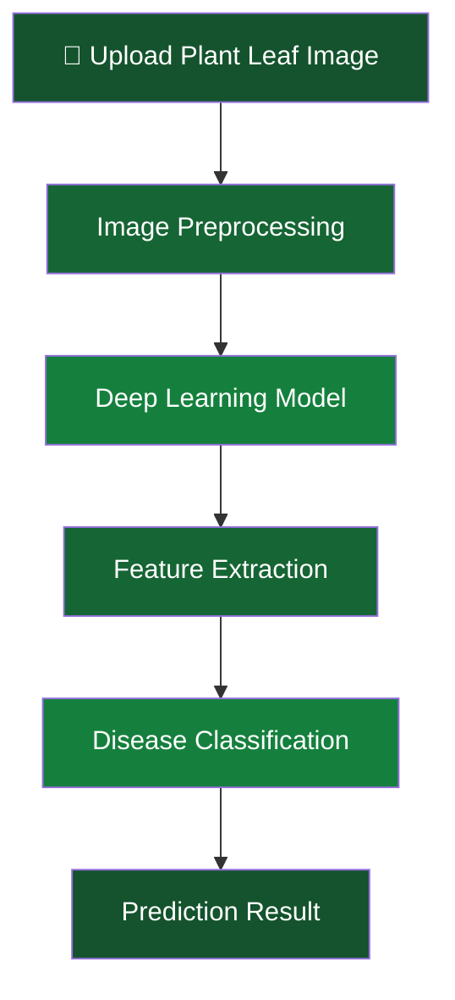

# 🌿 Plant Disease Detection
### Detect. Analyze. Protect. — AI for a Greener Tomorrow.

<p align="center">
  
  
  
</p>

<p align="center">
  <b>Harnessing the power of AI to identify plant diseases and support healthier agriculture.</b>
</p>

---

## 🌱 About The Project

Plant diseases can significantly affect agricultural productivity, crop quality, and food security.

**Plant Disease Detection** is an Artificial Intelligence project that explores how Deep Learning and Computer Vision can be used to identify plant diseases through leaf image analysis.

The system processes plant leaf images and uses a trained classification model to recognize patterns associated with different plant health conditions.

Our goal is to make AI-powered plant health analysis more accessible and contribute to the development of smarter agricultural solutions.

## ✨ Key Features

| Feature | Description |
|---|---|
| 🌿 Image-Based Detection | Analyze plant leaf images. |
| 🧠 AI-Powered Analysis | Apply deep learning techniques to image classification. |
| 🔍 Disease Identification | Identify potential disease categories from images. |
| ⚡ Automated Processing | Process images through an automated workflow. |
| 📊 Smart Predictions | Generate model-based classification results. |
| 🌍 Agricultural Innovation | Explore AI applications in modern agriculture. |

## 🧬 How It Works

The project follows an image classification workflow:



### Workflow Explanation

1. **Image Input:** Provide an image of a plant leaf.
2. **Preprocessing:** Prepare the image for model processing.
3. **Feature Extraction:** The model analyzes visual patterns.
4. **Classification:** The trained model predicts the corresponding category.
5. **Prediction:** Display the model's classification result.

## 🛠️ Technology Stack

The following technologies represent the project's core development areas. Update the library list to match your implementation.

<p align="center">
  
</p>

| Technology | Application |
|---|---|
| Python | Programming |
| Deep Learning | Model training and classification |
| Computer Vision | Image analysis |
| Image Processing | Image preprocessing |
| Git | Version control |
| GitHub | Project hosting and collaboration |


```

*Illustrative structure. Adapt the directory names to your actual repository.*

## ⚙️ Getting Started

Follow these instructions to set up the project locally.

### 1. Clone the Repository

```bash
git clone https://github.com/solodev-code/Plant-Disease-Detection.git
```

### 2. Navigate to the Project

```bash
cd Plant-Disease-Detection
cd "Plant Disease Detection"
```

### 3. Create a Virtual Environment

```bash
python -m venv venv
```

**Windows**

```bash
venv\Scripts\activate
```

**Linux / macOS**

```bash
source venv/bin/activate
```

### 4. Install Dependencies

If your repository includes `requirements.txt`:

```bash
pip install -r requirements.txt
```

### 5. Run the Project

Execute the project's actual Python application or notebook entry point.

## 📸 Project Screenshots

Add screenshots of your actual application to showcase its functionality.

| Plant Image Input | Disease Prediction |
|---|---|
| Add upload interface screenshot | Add prediction result screenshot |

Example image references:

```markdown


```

## 🚀 Future Enhancements

- [ ] Expand plant species and disease classification.
- [ ] Improve model performance and reliability.
- [ ] Develop an interactive web application.
- [ ] Build an Android application.
- [ ] Add multilingual support.
- [ ] Provide disease information and treatment guidance.
- [ ] Explore real-time camera-based detection.
- [ ] Integrate explainable AI visualization.

## 🌍 Why This Project Matters

We believe Artificial Intelligence can play an important role in modern agriculture.

This project explores how technology can contribute to:

- Early identification of potential plant diseases.
- More accessible plant health analysis.
- Improved agricultural monitoring.
- Smarter and technology-driven farming solutions.

**Technology meets nature. Intelligence supports agriculture.**

## 🤝 Contributing

Contributions and suggestions are welcome!

1. Fork this repository.
2. Create a new branch.
3. Make your changes.
4. Commit and push your changes.
5. Submit a Pull Request.

## 👨‍💻 Developer

**Sunny Pandey**

B.Tech Computer Science & Engineering  
Data Science & Artificial Intelligence

<p align="left">
  <a href="https://github.com/solodev-code">
    
  </a>
</p>

**Project Repository:**  
https://github.com/solodev-code/Plant-Disease-Detection

---

<p align="center">
  <h3 align="center">🌿 DETECT. ANALYZE. PROTECT.</h3>
  <p align="center">
    <i>Building a smarter and healthier agricultural future with Artificial Intelligence.</i>
  </p>
  <p align="center">
    ⭐ If you like this project, don't forget to give it a star!
  </p>
</p>

<p align="center">
  <sub>MADE WITH 💚 FOR A GREENER TOMORROW</sub>
</p>
